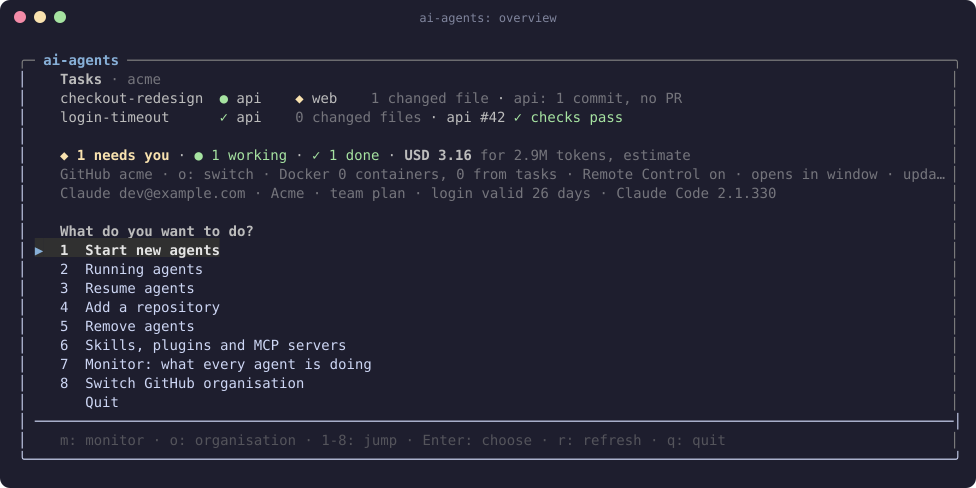
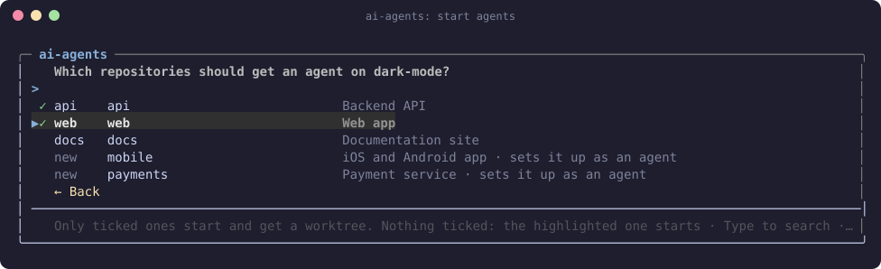
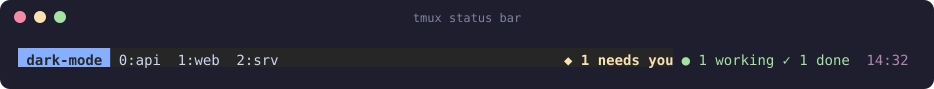
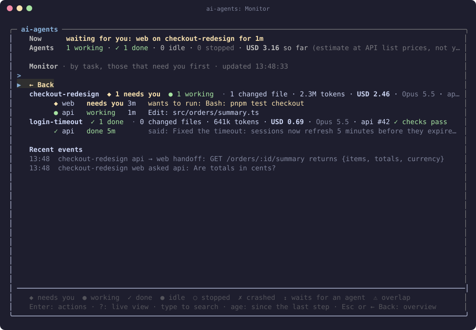
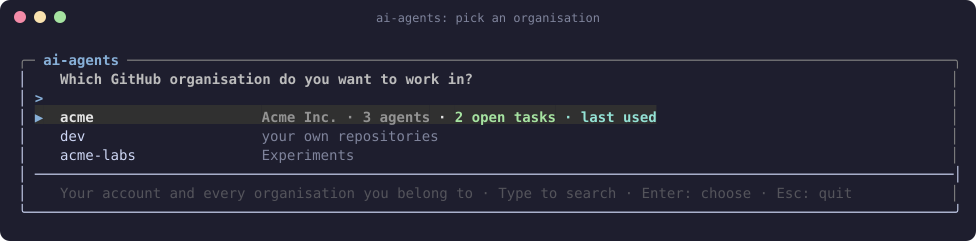

# agent-supervisor

Run a team of Claude Code agents on one task: one agent per GitHub repository, all on the same branch, side by side in tmux. You start them from a menu, and it tells you who works, who is done and who needs you.



## Get started

**1. Install the tools.** You need a Mac with [Claude Code](https://claude.com/claude-code) logged in. Then:

```sh
brew install tmux fzf jq gh
gh auth login
```

**2. Install `ai-agents`.**

```sh
git clone https://github.com/juhasztibi/agent-supervisor ~/Projects/agent-supervisor
mkdir -p ~/.local/bin && ln -s ~/Projects/agent-supervisor/ai-agents ~/.local/bin/ai-agents
ai-agents selftest   # about 3 minutes; uses its own test setup, touches nothing of yours
```

`~/.local/bin` must be on your `PATH`. Any other folder on your `PATH` works too.

**3. Let the agents talk to each other** without asking you each time. Add this to `~/.claude/settings.json`, under `permissions.allow`:

```json
"Bash(ai-agents ls)", "Bash(ai-agents start *)", "Bash(ai-agents stop *)",
"Bash(ai-agents handoff *)", "Bash(ai-agents wait *)", "Bash(ai-agents inbox)",
"Bash(ai-agents ask *)", "Bash(ai-agents reply *)", "Bash(ai-agents send *)"
```

**4. Add the tmux keys** to `~/.tmux.conf`, then run `tmux source-file ~/.tmux.conf`:

```tmux
bind a display-popup -E -w 90% -h 90% "AA_POPUP=1 AA_OPEN=here ~/.local/bin/ai-agents"
bind J run-shell "~/.local/bin/ai-agents next '#{pane_id}'"
bind O run-shell "~/.local/bin/ai-agents monitor-pane '#{pane_id}'"
set -g status-right "#(~/.local/bin/ai-agents status) %H:%M"
set -g status-interval 5
```

**5. Start your first task.** Run `ai-agents` (or press `prefix + a` in tmux) and answer the questions. Enter accepts the suggestion.

1. Pick your GitHub organisation.
2. Choose `1 Start new agents`, then `+ New task`, and give it a name. It becomes the branch name.
3. Tick the repositories with Space. Repositories you don't have on your Mac are cloned.
4. Type what the agents should do, or leave it empty and tell them later.



The agents open in a new window, each in its own copy of its repository. The first time, Claude Code may ask whether you trust the folder. Choose Yes.

## Every day

| You want to | Do this |
|---|---|
| See who needs you | Look at the status bar, or open the Monitor with `m` |
| Answer an agent | `prefix + J` takes you to the agent that has waited longest. Press it again for the next one |
| Give an agent a new instruction | Monitor, then Enter on the agent, then "Send … a message" |
| Continue tomorrow | `3 Resume agents` picks up every conversation where it stopped |
| Ship it | Monitor, then Enter on the task, then "Finish": every agent opens its pull request, and the task cleans itself up once all are merged |
| Stop for good | `5 Remove agents`. The branches stay |



The Monitor shows every task, what each agent is doing right now, and what happened recently:



**States:** ◆ needs you · ● working · ✓ done, your turn · ● idle · ○ stopped · ✗ crashed · ⧗ waits for another agent · ⚠ overlaps another task.

**Keys:** Enter chooses, Esc or `← Back` goes back, and you can type to search. Every screen shows its keys at the bottom.

---

## The details

### What it does for you

- **Any GitHub organisation.** Pick your account or an organisation; every repository is offered.
- **One task, one branch everywhere.** Each agent works in its own git worktree, so your own checkouts stay untouched.
- **Agents work together.** They hand committed work to each other, ask each other questions and say what they wait for. All of it is tracked.
- **Overlap warnings.** Before an agent edits a file that another task already changed, it is asked to agree with that task's agent first.
- **Notifications** when an agent needs you, may be stuck, or crashed.
- **Recovery.** A crashed agent restarts and continues its conversation, at most 3 times an hour. After a Mac restart, one menu item resumes every task.
- **Costs** per task and agent, estimated at Anthropic's API list prices. This is not your bill.



### How agents work together

Agents talk only through `ai-agents`, so every message is stored, delivered and tracked. They run these from their own session:

- `handoff <agent|all> "what changed"`, after committing: points the others at the commit and ends their waits.
- `wait <agent> "what I need"`: the Monitor shows "⧗ waiting for api" until the handoff arrives.
- `ask <agent> "question"`, `reply <id> "answer"`, `send <agent|all> "note"`, `inbox`. `agent@task` reaches an agent of another task.

Nothing is typed into an agent's pane. Claude Code hooks add new messages to its context at its next step. An idle agent is woken by a background hook (`asyncRewake`) with the messages themselves, and a stopped agent gets them when it starts. Your own `ai-agents say` messages travel the same way. The watchdog tells you about messages it can't deliver, questions unanswered for 15 minutes and waits longer than 30 minutes.

When an agent is about to edit a file that an agent of another task already changed in the same repository, that first edit is stopped. The agent is told to ask the other one (`ai-agents ask api@login-timeout "..."`) and agree who does it. Once they agree, the same edit goes through.

### Trust model

All agents run as your user, so an agent with free shell access can do anything you can, including writing the message files or posing as you. The message system keeps honest agents, and agents misled by what they read (an issue, another agent's message), apart from your instructions: other agents' words always arrive quoted, and `say` refuses to run from an agent. The real boundary is Claude Code's permission settings, so don't give agents unrestricted shell access.

### Commands

The menu covers everything. These are for scripts and for the agents themselves.

```sh
ai-agents up <task> "goal" --only api,web     # new task with these agents
ai-agents start <task> api --model opus       # start or add an agent
ai-agents say <task> all "rebase on main"     # a message to every agent of the task
ai-agents ls                                   # what runs where
ai-agents finish <task>                        # every agent opens its pull request; cleans up once merged
ai-agents next                                 # go to the agent that has waited longest for you
ai-agents status                               # the line for the tmux status bar
ai-agents stop <task> web | resume <task> | down <task> --prune
ai-agents orgs | org <owner> | --org <owner> <command>
ai-agents help                                 # everything else
```

### Settings

Per organisation, in `~/.config/ai-agents/orgs/<owner>/`: `repos` lists the agents, and an optional `settings` file holds tab-separated `worktrees <folder>`, `prefix <tmux prefix>` and `issues <owner/repo>`.

Environment variables:

| Variable | What it sets | Default |
|---|---|---|
| `AA_OPEN` | Where a task opens: window, tab, here, detached | window |
| `AA_LAYOUT` | Agents in their own window, or split side by side: own, split | own |
| `AA_REMOTE` | Remote Control, to follow agents on claude.ai and the Claude app: on, off | on |
| `AA_NOTIFY` | Mac notifications: on, off | on |
| `AA_AUTO_RESTART` | Restart crashed agents: on, off | on |
| `AA_CLONE_ROOT` | Where new clones go | `~/code` |
| `AA_CURRENCY` | Currency for costs, or write it to `~/.config/ai-agents/currency` | USD |
| `AA_THEME` | light or dark | from the terminal |
| `AA_DONE_SEC` | How long a finished agent shows as done | 3600 |
| `AA_ANSWER_SEC`, `AA_WAIT_SEC` | When to tell you about unanswered questions and long waits | 900, 1800 |

### Requirements

Each minimum is the release that added the newest feature `ai-agents` uses.

| Tool | Minimum | Why that version | Tested with |
|---|---|---|---|
| [Claude Code](https://claude.com/claude-code) | 2.1.287 | `asyncRewake` hooks wake idle agents (also needs `--name` 2.1.76, `StopFailure` 2.1.78) | 2.1.330 |
| tmux | 3.2 | `new-session -e`; also the `prefix + a` popup | 3.8 |
| fzf | 0.71.0 | `--track --id-nth` keeps the cursor on the same row while lists refresh | 0.75.0 |
| GitHub CLI `gh`, logged in | 2.7.0 | `gh search issues --owner` for the issue picker | 2.96.0 |
| git | 2.22 | `git branch --show-current` | 2.50.1 |
| jq | 1.5 | `--slurpfile`, `@tsv`, regex functions | 1.8.2 |
| bash | 3.2 | the one macOS ships at `/bin/bash` | 3.2.57 |
| curl | 7.40 | `--unix-socket` for live refresh | 8.7.1 |

Also used, all part of macOS: `osascript` (notifications), `perl` and `md5`. Tested on macOS 26.7. iTerm2 and Docker are optional. Claude Code 2.1.287 is a safe minimum, not an exact one: `asyncRewake` exists there, but its changelog doesn't say when it was added.

### Screenshots and tests

`ai-agents selftest` runs about 200 checks in their own tmux server, with a fake Claude Code, GitHub and Docker. `docs/screenshots/make.sh` rebuilds the images above from a demo setup with a made-up organisation.

## License

MIT, see [LICENSE](LICENSE).
